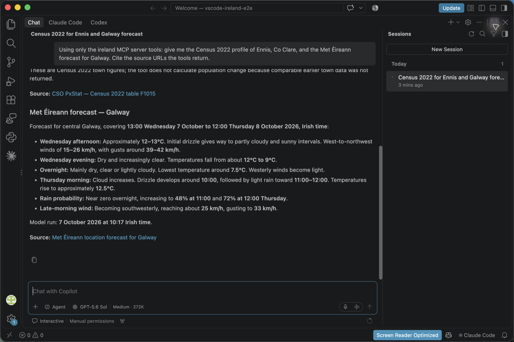
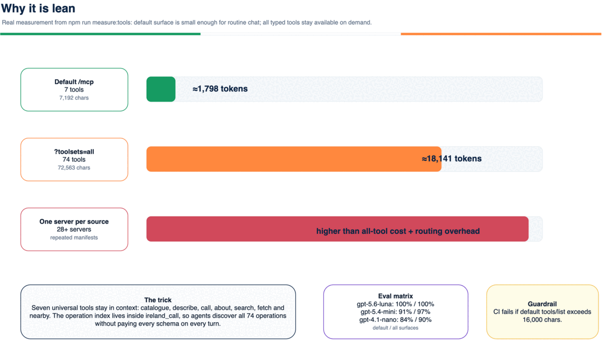

# Ireland MCP

[](https://github.com/c-mongan/ireland-mcp/actions/workflows/ci.yml)
[](LICENSE)
[](https://modelcontextprotocol.io)
[](#why-its-lean)

**Ask ChatGPT, Claude or Copilot about Ireland, and get answers that cite official public sources.**

Ireland MCP is a free connector for AI assistants. It lets your assistant look up Irish public data, such as census figures, train times, weather warnings, house prices and Dáil business, and tell you where every number came from. Website: [irishopendata.ie](https://irishopendata.ie).

- **Free, with no account or API key.** Paste one web address into your assistant.
- **Read-only.** It only looks things up. It cannot change or submit anything.
- **Official sources.** Answers come back with the publisher, licence and the time the data was fetched, so you can check them.
- **Open source** under the MIT licence. An unofficial community project, not a government service.

## What can I ask?

- “What is the latest population profile for Galway city or County Cork?”
- “Are there Met Éireann weather warnings near Dublin today?”
- “What did houses sell for in Ennis last year?”
- “When is the next train from Heuston, and are there disruptions?”
- “Who are the current TDs for my constituency, and what bills are active?”
- “What protected habitats, monuments, planning applications or census areas are near this point?”

The assistant writes the answer; Ireland MCP supplies the data and its source. Check the date and source before you rely on a figure.

## Set it up in 30 seconds

The server address is `https://mcp.irishopendata.ie/mcp`. It needs no sign-in.

- **ChatGPT:** Plugins → **+** → **Add custom MCP server** → paste the address → **No authentication**. [Full steps](#connect-your-assistant).
- **Claude:** Settings → Connectors → **Add custom connector** → paste the address.
- **GitHub Copilot CLI:**

  ```sh
  copilot mcp add --transport http ireland https://mcp.irishopendata.ie/mcp
  ```

- **VS Code:** add `.vscode/mcp.json`:

  ```json
  { "servers": { "ireland": { "type": "http", "url": "https://mcp.irishopendata.ie/mcp" } } }
  ```

**Check it works.** Ask: *"Using the ireland tools, give me the Census 2022 profile of Ennis, Co Clare, and the Met Éireann forecast for Galway. Cite the sources."* The answer should link `https://data.cso.ie/table/F1015` and the Met Éireann forecast URL.<sup>†</sup>

<sub>† The forecast URL is `http://`: Met Éireann's `https://` host currently redirects to an origin that fails TLS.</sub>

<p align="center">
  
</p>

## Beta features

Beta features are off on the hosted server. You can turn them on when you run your own copy.

### Beta: Irish law & your rights (annual leave and working time)

> **Not legal advice.** For your own situation, contact [Citizens Information](https://www.citizensinformation.ie), the [Workplace Relations Commission](https://www.workplacerelations.ie) or a solicitor.

An optional pilot finds Irish employment-law evidence and quotes it with links. It covers only two topics today: **annual leave and working time**.

- **What it reads:** two Citizens Information guidance pages, the Organisation of Working Time Act 1997 and the Irish Statute Book page listing that Act's later changes.
- **Act text is as passed in 1997.** It may not include later amendments. Check the changes page and the cited source.
- **Citizens Information blocks automated access today.** Its firewall refused the pilot's requests on 26 October 2026, so a sync may fetch only the Irish Statute Book pages. We will not disguise the pilot as a browser. Wider coverage needs permission or an official export from the Citizens Information Board; we are asking.
- **AI summaries can be wrong.** Every answer quotes its sources. Read them.

Without the beta, the default `legislation` source quotes Irish law as enacted, live from the Irish Statute Book. In this revision that covers Acts, statutory instruments and the Constitution; check `ireland_describe` for what a given server offers. The beta adds Citizens Information guidance and stored, versioned evidence.

Try it on your own machine:

```sh
npm run legal:sync    # fetch the seed pages into .irish-legal-cache
npm run legal:serve   # chat page and tools at http://127.0.0.1:4173
```

`legal:sync` exits with an error while any page fails. Today that is expected for the Citizens Information pages; the Irish Statute Book pages are still saved.

Or add it to the main server with `LEGAL_ENABLED=true` (off by default). Read the [beta assessment](docs/legal-beta-assessment.md) and [pilot guide](packages/irish-legal-mcp/README.md) first.

---

<details>
<summary><strong>For developers: endpoint details</strong></summary>

Hosted endpoint: `https://mcp.irishopendata.ie/mcp`
Transport: Streamable HTTP. Auth: none. Writes: none.
Registry: [`io.github.c-mongan/ireland-mcp`](https://registry.modelcontextprotocol.io/v0.1/servers/io.github.c-mongan%2Fireland-mcp/versions/latest) on the official MCP Registry.

</details>

## Connect your assistant

| Client | Current setup |
| --- | --- |
| Claude custom connector | Settings → Connectors → **Add custom connector** → URL `https://mcp.irishopendata.ie/mcp` → no auth. |
| ChatGPT plugin | In ChatGPT on the web, open **Plugins** → **+** → **Add custom MCP server**. Name it **Ireland Open Data**, enter `https://mcp.irishopendata.ie/mcp`, select **No authentication**, review the warning and select **Create as a plugin**. Install it, open a new **Work** chat and select `@Ireland Open Data`. Reuse the installed plugin if it is already present. See the [OpenAI plugin quickstart](https://developers.openai.com/plugins/quickstart) and [tested connection route](docs/playground-auth.md#use-ireland-mcp-in-chatgpt). |
| VS Code | Install link (paste into a browser or run `open` on it): `vscode:mcp/install?%7B%22name%22%3A%22ireland%22%2C%22type%22%3A%22http%22%2C%22url%22%3A%22https%3A%2F%2Fmcp.irishopendata.ie%2Fmcp%22%7D`. Or add `.vscode/mcp.json`: `{ "servers": { "ireland": { "type": "http", "url": "https://mcp.irishopendata.ie/mcp" } } }`. |
| VS Code Insiders | Install link: `vscode-insiders:mcp/install?%7B%22name%22%3A%22ireland%22%2C%22type%22%3A%22http%22%2C%22url%22%3A%22https%3A%2F%2Fmcp.irishopendata.ie%2Fmcp%22%7D`. |
| Cursor | Deeplink: [`cursor://anysphere.cursor-deeplink/mcp/install?name=ireland&config=...`](cursor://anysphere.cursor-deeplink/mcp/install?name=ireland&config=eyJ0eXBlIjoiaHR0cCIsInVybCI6Imh0dHBzOi8vbWNwLmlyaXNob3BlbmRhdGEuaWUvbWNwIn0=). Decoded config: `{ "type": "http", "url": "https://mcp.irishopendata.ie/mcp" }`. |
| GitHub Copilot CLI | `copilot mcp add --transport http ireland https://mcp.irishopendata.ie/mcp` or put the JSON below in `~/.copilot/mcp-config.json`. |
| Claude Code | `claude mcp add --transport http ireland https://mcp.irishopendata.ie/mcp` |
| Local (stdio, no hosted endpoint) | `npx -y ireland-mcp`. Add typed tools with `--toolsets=cso,irish-rail`. See [self-hosting](docs/self-hosting.md). |

Portable Copilot / MCP JSON:

```json
{
  "mcpServers": {
    "ireland": {
      "type": "http",
      "url": "https://mcp.irishopendata.ie/mcp",
      "tools": ["*"]
    }
  }
}
```

## What's inside

<!-- counts:start (generated by `npm run counts`; CI checks it) -->
| Count | Value | Definition |
| --- | ---: | --- |
| Data sources | 38 | Upstream public-data sources, one module each. The `cross` combiner is not a source. |
| Available without an operator key | 36 of 38 | NTA realtime needs an operator key. Logainm needs a Gaois operator account and API key. |
| Catalogue operations | 90 | 87 source operations plus 3 cross-source ones (`list_sources`, `nearby`, `ireland_snapshot`), all callable through `ireland_call`. |
| Default tools | 7 | What `tools/list` returns: 4 meta tools plus `search`, `fetch` and `nearby`. |
| Tools with `?toolsets=all` | 96 | Every operation as a typed tool, plus the 4 meta tools, `search` and `fetch`. |
| Prompts | 3 | `area_profile`, `commute_check`, `compare_counties`. |
<!-- counts:end -->

Last full run of every operation then in the catalogue against the hosted endpoint: <!-- live-ops:start -->[docs/live-all-ops.md](docs/live-all-ops.md) (2026-10-26): 78 of 82 pass, 1 fail; 3 need an operator key (NTA, Logainm).<!-- live-ops:end -->

The default profile covers statistics (CSO, Eurostat, ECB, World Bank), the Oireachtas and Irish Statute Book, Met Éireann, transport (Irish Rail, Luas, NTA, TFI stops, bikes), property, planning, heritage, environment, energy, tourism, lobbying, pay-gap reports, council budgets and more. An optional [Irish legal and Citizens Information pilot](packages/irish-legal-mcp/README.md) is off by default; see [Beta features](#beta-features).

<details>
<summary><strong>All 39 sources, publishers and licences</strong></summary>

The default profile registers 39 source modules in `src/registry.ts`. The default `nearby`, `search` and `fetch` shortcuts sit above these sources. The optional pilot rows require `LEGAL_ENABLED=true` and an ingested corpus; check `ireland_catalogue` for the modules available on an endpoint. See [new provider access and limits](docs/public-source-additions.md).

| Domain | Source id | Publisher / source | Operations | Licence |
| --- | --- | --- | ---: | --- |
| places/property | `failte-ireland` | [Fáilte Ireland accommodation and attractions](https://www.failteireland.ie/en/info/open-data) | 1 | CC BY 4.0 |
| transport | `tfi-static` | [TFI NaPTAN static stops](https://www.transportforireland.ie/transitData/PT_Data.html) | 1 | CC BY 4.0 |
| environment | `gsi` | [GSI groundwater vulnerability](https://data.gov.ie/dataset/groundwater-vulnerability-140000-ireland-roi-itm) | 1 | CC BY 4.0 |
| places/property | `logainm` | [Logainm / Gaois placenames](https://docs.gaois.ie/en/data/logainm/v1.0/api) — operator key required | 1 | CC BY 4.0 |
| stats | `ncse` | [NCSE school allocations](https://opendata.ncse.ie) ([operations](docs/ncse-school-allocations.md)) | 3 | Creative Commons Attribution; check dataset terms |
| stats | `cso` | [Central Statistics Office (CSO) PxStat](https://data.cso.ie) | 4 | CC BY 4.0 |
| economy | `world-bank` | [World Bank Open Data](https://data.worldbank.org/country/ireland) | 2 | CC BY 4.0 |
| stats | `eurostat` | [Eurostat Statistics API](https://ec.europa.eu/eurostat) | 3 | Eurostat reuse policy (CC BY 4.0 equivalent) |
| stats | `ecb` | [ECB Data Portal](https://data.ecb.europa.eu) | 3 | ECB terms, free reuse with attribution |
| stats | `pobal` | [Pobal HP Deprivation Index 2022](https://data.gov.ie/dataset/pobal-hp-deprivation-index-scores-2022) | 1 | CC BY 4.0 |
| stats | `data-gov-ie` | [data.gov.ie](https://data.gov.ie) | 3 | Per dataset, mostly CC BY 4.0 |
| economy | `cro` | [Companies Registration Office open data](https://opendata.cro.ie) | 3 | CC BY 4.0 |
| economy | `kohesio` | [European Commission Kohesio](https://kohesio.ec.europa.eu/) — packaged, dated Irish CSV exports; not live data ([refresh guide](docs/kohesio-exports.md)) | 2 | EU reuse policy / CC BY 4.0 compatible |
| stats | `smart-dublin` | [Smart Dublin open data](https://data.smartdublin.ie) | 3 | Per dataset, mostly CC BY 4.0 |
| stats | `census-areas` | [CSO Census 2022 small areas / Tailte Éireann](https://data-osi.opendata.arcgis.com/datasets/osi::cso-small-areas-national-statistical-boundaries-2022-generalised-20m) | 1 | CC BY 4.0 |
| law/politics | `lobbying` | [SIPO Register of Lobbying](https://www.lobbying.ie/) — published returns ([notes](docs/lobbying-source.md)) | 1 | SIPO PSI reuse policy |
| economy | `paygap` | [PayGap.ie](https://paygap.ie/downloads) — employer reports with annotations ([notes](docs/civic-sources.md)) | 1 | CC0 1.0 |
| economy | `council-budgets` | [Official council budget workbooks](https://data.gov.ie/dataset/local-authority-and-regional-assembly-annual-budgets) ([notes](docs/council-budgets-source.md)) | 2 | CC BY-SA 4.0 |
| law/politics | `oireachtas` | [Houses of the Oireachtas Open Data API](https://api.oireachtas.ie) — includes bill stages linked to the enacted Act | 6 | Oireachtas Open Data PSI Licence |
| law/politics | `legislation` | [Irish Statute Book](https://www.irishstatutebook.ie) — Acts and SIs as enacted/made, the Constitution, amendment and commencement directory | 7 | [Oireachtas (Open Data) PSI Licence](https://www.irishstatutebook.ie/eli/open-data.html) (incorporates CC BY 4.0) |
| law/politics | `eu-law` | [Publications Office of the EU — Cellar SPARQL](https://op.europa.eu/en/web/cellar) — EU act metadata by CELEX or ELI | 1 | [Commission Decision 2011/833/EU reuse notice](https://data.europa.eu/data/datasets/sparql-cellar-of-the-publications-office) |
| law/politics | `irish-legal` (optional pilot) | [Irish legal evidence corpus](packages/irish-legal-mcp/README.md) — indexed source versions and Act sections; annual-leave/working-time seeds; current law unverified | 6 | Per-document publisher licence; Revised Acts storage and redistribution permission gated |
| stats | `cib` | [Citizens Information Board Data Hub](https://www.citizensinformationboard.ie/en/data-hub/) — pinned, checksummed annual CIS and CIPS statistics 2021–2025; not live data ([notes](docs/cib-and-civic-directory.md)) | 3 | CC BY 4.0 |
| law/politics | `civic-directory` | [Éire Civic Tech Directory](https://github.com/williamkennedy/eire_civic_tech_directory) behind [CitizenData.ie](https://citizendata.ie/) — pinned catalogue; status and links as listed, unverified ([notes](docs/cib-and-civic-directory.md)) | 1 | MIT (catalogue) |
| law/politics | `citizens-info` (optional pilot) | [Citizens Information Board](https://www.citizensinformation.ie) — indexed explanatory guidance from the limited pilot corpus | 2 | CC BY 4.0; third-party material excluded |
| places/property | `geohive` | [Tailte Éireann GeoHive boundaries](https://www.geohive.ie) | 4 | CC BY 4.0 |
| places/property | `wikidata` | [Wikidata](https://www.wikidata.org) | 2 | CC0 1.0 |
| places/property | `ppr` | [Residential Property Price Register](https://www.propertypriceregister.ie) | 2 | PSI General Licence / CC BY 4.0 |
| places/property | `planning` | [National Planning Application Database](https://data-housinggovie.opendata.arcgis.com/maps/housinggovie::irishplanningapplications) | 2 | CC BY 4.0 |
| places/property | `heritage` | [National Monuments Service SMR](https://maps.archaeology.ie/historicenvironment) | 1 | CC BY 4.0 |
| environment | `met-eireann` | [Met Éireann](https://www.met.ie) | 3 | CC BY 4.0 |
| environment | `marine` | [Marine Institute weather buoys](https://data.gov.ie/dataset/weather-buoy-network) | 1 | CC BY 4.0 |
| environment | `opw-water` | [OPW waterlevel.ie](https://waterlevel.ie/) | 2 | CC BY 4.0 |
| environment | `environment-sites` | [NPWS designated protected sites](https://experience.arcgis.com/experience/edf34d92e28040fd87d3d14f55d8d95f/) | 2 | CC BY 4.0 |
| environment | `epa` | [EPA WFD and bathing-water open data](https://data.epa.ie/api-list/) ([operations](docs/epa-bathing-water.md)) | 5 | CC BY 4.0 |
| transport | `nta` | [National Transport Authority GTFS-Realtime](https://developer.nationaltransport.ie) | 2 | CC BY 4.0 |
| transport | `irish-rail` | [Iarnród Éireann realtime API](https://api.irishrail.ie/realtime/) | 2 | Public open data; attribution required |
| transport | `luas` | [Luas Forecasting API / TII](https://data.gov.ie/dataset/luas-forecasting-api) | 2 | CC BY 4.0 |
| transport | `bikes` | [CityBikes / GBFS](https://api.citybik.es/v2/) | 2 | CityBikes attribution/link; underlying operator terms |
| energy | `eirgrid` | [EirGrid Smart Grid Dashboard](https://www.smartgriddashboard.com/) | 1 | Public information; attribution required |
| economy | `ted` | [EU TED](https://ted.europa.eu/) | 2 | EU reuse policy / CC BY 4.0 |

The civic-source additions and GeoHive layer selection are described in [civic source notes](docs/civic-sources.md). Counts describe the code in this revision, not a deployment receipt. Check the connected server with `ireland_catalogue`; verify a release with `node scripts/live-civic.mjs --url https://mcp.irishopendata.ie/mcp`.

</details>

## Why it's lean

Most data MCPs expose every typed tool up front. Ireland MCP keeps the default `tools/list` to **7 tools, 8,941 characters, about 2,235 tokens** (`toolsets=all` is 96 tools, about 28k tokens) (`npm run measure:tools`). CI fails if that list grows past 16,000 characters.

<p align="center">
  <a href="docs/architecture/ireland-mcp-lean-surface.drawio">
    
  </a>
</p>

Need typed tools anyway?

| Surface | Use |
| --- | --- |
| Default HTTP | `/mcp` lists only `ireland_catalogue`, `ireland_describe`, `ireland_call`, `ireland_about`, `search`, `fetch`, `nearby`. |
| Source toolsets | `/mcp?toolsets=cso,irish-rail` lists selected typed tools too. |
| One source path | `/mcp/x/{source}` lists that source's typed tools, for example `/mcp/x/met-eireann`. |
| Everything | `/mcp?toolsets=all` lists all available tools and is useful for debugging, not routine chat. |
| Local stdio | `npx -y ireland-mcp --toolsets=cso` or `--toolsets=all`. |

`max_tokens` defaults to about 2,000 output tokens and can be set from 100 to 8,000. Large results return `truncated`, counts and narrowing hints instead of flooding the context.

## Hosted or self-hosted

- **Use the hosted endpoint** (`https://mcp.irishopendata.ie/mcp`) unless you have a reason not to. It's free, needs no keys, and the maintainer keeps it running.
- **Run it yourself** with `npx -y ireland-mcp` (stdio), `npm run dev:http` (local HTTP), or your own Azure deployment. See [docs/self-hosting.md](docs/self-hosting.md).
- **Contribute a source** if something Irish and public is missing. See [Contributing](#contributing).

## Privacy and usage counts

- Read-only, no accounts, and no argument values or IP addresses in logs or telemetry.
- The hosted service keeps aggregate usage counts in PostHog: which sources and client apps are used, with no identities. The website counts anonymous page views without cookies. [PRIVACY.md](PRIVACY.md) lists every field.
- Self-hosted copies never send usage counts unless you configure PostHog. An Azure deployment from the templates exports traces and metrics to your own Application Insights; set `IRELAND_MCP_OTEL=off` to stop that. Local stdio and HTTP send nothing.
- `GET /healthz` (add `?deep=1` for per-source checks) and a public [status feed](https://raw.githubusercontent.com/c-mongan/ireland-mcp/status/status/status.json) report service health.

## Limits

- Read-only public data only. No login-gated, paid or key-required user data.
- NTA realtime and Logainm placenames need server-side operator keys; every other source works without one.
- Upstream data can be delayed, provisional, incomplete or temporarily down. Stale cache is labelled `stale: true` and is used only for retryable failures. Permanent request, access and missing-resource errors remain visible.
- Property Price Register values are declared sale prices, not valuations.
- Legislation text is for retrieval and analysis, not legal advice. The optional legal pilot covers only ingested pages. Enacted text, Citizens Information guidance and any permitted consolidation require verification of amendments, commencement and source currency; they do not certify current law.
- Large tables are paginated or truncated. Use `fields`, `limit`, `cursor` and source filters.

## Contributing

New sources are the most useful contribution. [Request one](https://github.com/c-mongan/ireland-mcp/issues/new?template=source_request.yml), or add it yourself:

1. Create `src/sources/<id>/index.ts` exporting a `SourceModule` with `info`, `summary`, `domain`, `coverage`, tools, optional `search()` and `fetchById()`. A source with `search()` must also implement `fetchById()` for the ids it returns.
2. Keep every tool name source-prefixed, validate args with zod and return the evidence envelope with source URL, licence and attribution.
3. Use `ctx.cachedJson` / `ctx.cachedText` so upstream budgets, caching, circuit breakers and stale fallback apply.
4. Add fixtures and tests at the module seam, then add a server-level `ireland_call` test when useful.
5. Register the module in `src/registry.ts`, update `scripts/live-sanity.mjs`, eval cases and docs.
6. Run lint, typecheck, tests, build, inspector and live sanity before opening a PR.

See [CONTRIBUTING.md](CONTRIBUTING.md) for the full checklist.

Development commands, evals and the quality loop are in [docs/development.md](docs/development.md).

## Licence and attribution

| Layer | Licence / attribution |
| --- | --- |
| Code | [MIT](LICENSE), copyright Conor Mongan. |
| Source metadata and returned data | Stays under each publisher licence. Every normal tool response includes `source`, `url`, `licence`, `attribution`, `retrieved_at`, cache and truncation metadata. |
| CSO / Eurostat / ECB / Wikidata / World Bank | Cite CSO, Eurostat, ECB Data Portal, Wikidata contributors and World Bank Open Data respectively; Wikidata is CC0. |
| Oireachtas / legislation / PSI sources | Cite Oireachtas Open Data, eISB / Office of the Attorney General, PSRA, OPW and other named PSI publishers as shown in responses. |
| CIB Data Hub / civic directory | CIB statistics: "Contains Irish Public Sector Data licensed under a Creative Commons Attribution 4.0 International (CC BY 4.0) licence", credit the Citizens Information Board. Directory: credit the Éire Civic Tech Directory (MIT, William Kennedy) and the listed project owners. |
| Optional legal pilot | Preserve per-document citations and Citizens Information Board attribution. Law Reform Commission Revised Acts reuse requires explicit permission; see [source policies](docs/irish-legal-source-policies.md). |
| Weather, transport, environment, business and maps | Cite Met Éireann, NTA, Iarnród Éireann, TII/Luas, EirGrid, Marine Institute, Tailte Éireann, NMS, NPWS, EPA, Pobal, CRO, Kohesio/TED and JCDecaux/CityBikes/GBFS as applicable. |
| Full notice | See [NOTICE](NOTICE). Not affiliated with any government body, data publisher or transport operator. |

<details>
<summary><strong>Credits and prior art</strong></summary>

Thank you to the maintainers of Irish-data and public-data MCP projects that helped shape the direction:

| Project | What to look at |
| --- | --- |
| [keithd1998/irlcli](https://github.com/keithd1998/irlcli) | Irish open-data CLI for LLM use. |
| [sumitsimplex/irish-mcps](https://github.com/sumitsimplex/irish-mcps) and [irishmcp.ie](https://irishmcp.ie) | Irish MCP platform and public-data UX. |
| [faulknco/archaic-stats-mcp](https://github.com/faulknco/archaic-stats-mcp) | CSO/PxStat MCP focused on Irish statistics. |
| [datagouv/datagouv-mcp](https://github.com/datagouv/datagouv-mcp) | National open-data catalogue MCP pattern. |
| [brockwebb/open-census-mcp-server](https://github.com/brockwebb/open-census-mcp-server) | Census-data MCP interface and interpretation pattern. |
| [ondata/ckan-mcp-server](https://github.com/ondata/ckan-mcp-server) | CKAN search/query server design. |
| [cyanheads/eurostat-mcp-server](https://github.com/cyanheads/eurostat-mcp-server) | Eurostat MCP implementation. |
| [isakskogstad/OECD-MCP](https://github.com/isakskogstad/OECD-MCP) | OECD statistical-data MCP. |

Data comes from the publishers listed above, including CSO, data.gov.ie, Met Éireann, OPW, Irish Rail, Oireachtas, GeoHive/Tailte Éireann, National Monuments Service, NPWS, EPA, Pobal, CRO, World Bank, Eurostat, ECB, Wikidata, Kohesio, TED, JCDecaux/CityBikes and others. Please cite the publisher shown in each response.

</details>

## More

- [Evidence: clients tested, screenshots and demo video](docs/evidence.md)
- [Architecture and request flow](docs/architecture.md)
- [Self-hosting](docs/self-hosting.md) · [Deploying to Azure](docs/deploy.md) · [Publishing](docs/publishing.md)
- [Observability](docs/observability.md) · [Privacy](PRIVACY.md) · [Security](SECURITY.md)

## Security

Security reports: [SECURITY.md](SECURITY.md). This project is read-only, but MCP servers can still retrieve untrusted web content; clients should follow their normal MCP trust and approval model.
