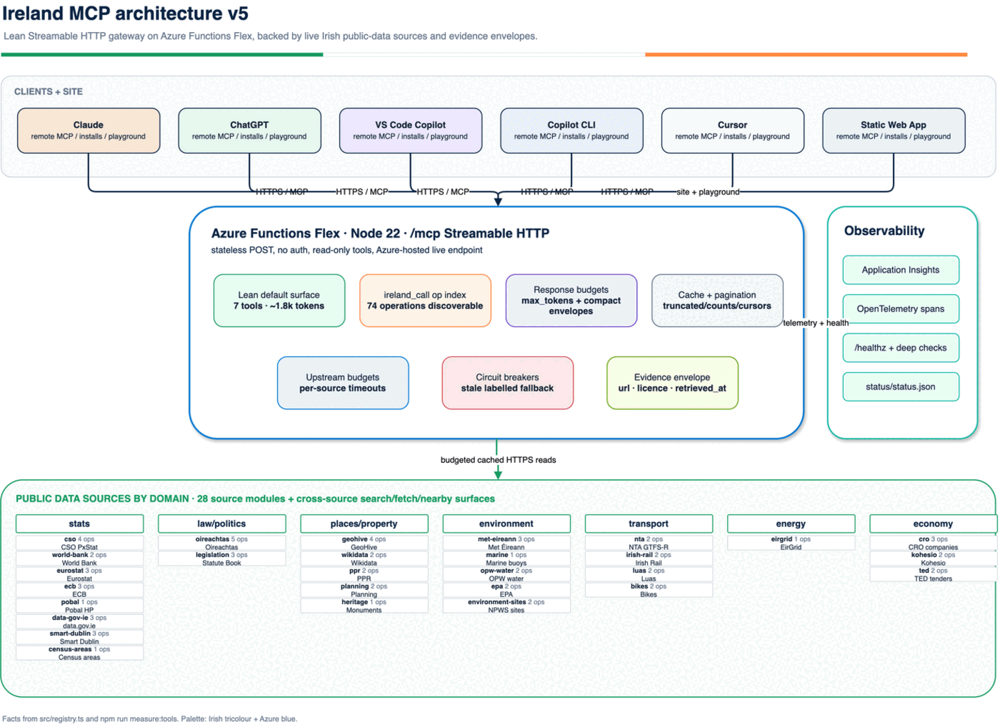
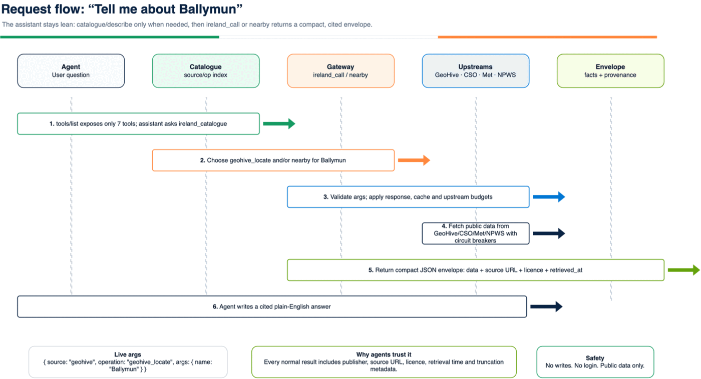
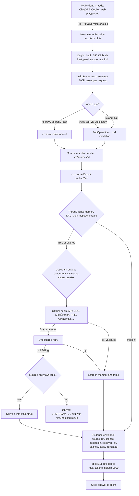

# Architecture

Ireland MCP is a read-only Model Context Protocol (MCP) server for Irish public data. An AI client asks a question, the server calls one or more official public APIs, and each operation result comes back with the publisher, source URL, licence, attribution and retrieval time attached. The raw `search` and `fetch` tools follow the ChatGPT connector shape instead: `search` returns `{ results: [{ id, title, url }] }`, and `fetch` returns `{ id, title, text, url, metadata }`. `metadata` always identifies the source; most adapters also include the licence and attribution, but EPA, Pobal, TED and World Bank do not yet ([#127](https://github.com/c-mongan/ireland-mcp/issues/127)).

The hosted server is a stateless Azure Functions Flex app at `https://mcp.irishopendata.ie/mcp`. The same code runs locally over stdio (`ireland-mcp`) or HTTP (`npm run dev:http`).

| Diagram | Editable source |
| --- | --- |
|  | [`ireland-mcp-arch-v5.drawio`](architecture/ireland-mcp-arch-v5.drawio) |
|  | [`ireland-mcp-request-flow.drawio`](architecture/ireland-mcp-request-flow.drawio) |
|  | [`ireland-mcp-lean-surface.drawio`](architecture/ireland-mcp-lean-surface.drawio) |

<p align="center">
  <a href="architecture/ireland-mcp-arch-v5.drawio">
    
  </a>
</p>

## Request to cited answer



In plain words:

1. **Host.** The Azure Function (`src/functions/mcp.ts`) checks the browser origin, rejects bodies over 256 KB and passes the request to `handleMcpHttp` (`src/gateway/httpHandler.ts`). That handler applies the rate limit and builds a new MCP server for each request. No session state is kept between requests.
2. **Tool surface.** By default clients see seven meta tools: `ireland_catalogue`, `ireland_describe`, `ireland_call`, `ireland_about`, `search`, `fetch` and `nearby`. Every source operation is reachable through `ireland_call(source, operation, args)`. Typed per-source tools appear only with `?toolsets=` or `/mcp/x/{source}` (`src/gateway/toolsets.ts`). `search` returns ids shaped `<source>:<key>`; every source with `search` also implements `fetchById`, so `fetch` can resolve each id (a contract test enforces this).
3. **Validation.** Arguments are checked against each operation's zod schema. Unknown keys and bad values return `BAD_ARGS` with the expected schema and an example (`src/gateway/server.ts`).
4. **Source adapter.** Each `src/sources/<id>/` module builds a fixed official URL. It never builds a URL from a user-supplied host. It reads through `ctx.cachedJson` or `ctx.cachedText` (`src/gateway/context.ts`).
5. **Cache.** `TieredCache` (`src/gateway/cache.ts`) checks an in-memory LRU, then the persistent `mcpcache` Azure Table. Concurrent identical reads share one upstream call. TTLs are set per call: about 30 seconds for live trams and a day for catalogues. Values that fail a source's `validate` check are not cached.
6. **Upstream.** `HttpClient` (`src/gateway/http.ts`) applies a 10-second default timeout and a 5 MiB default body cap (some sources set their own). It retries once on transient failures. Per-source concurrency and circuit breakers live in `src/gateway/upstreamBudget.ts`. If the refresh fails and an expired entry exists, that entry is served with `stale: true`.
7. **Envelope and budget.** `envelope()` (`src/gateway/envelope.ts`) attaches the citation fields. `applyBudget` trims the largest array or string to fit `max_tokens` and sets `truncated` with a hint.

## Component map

```text
ireland-mcp
├── src/cli.ts                 stdio entrypoint (--toolsets)
├── src/functions/             Azure Functions: mcp (/mcp, /mcp/x/{source}), healthz, legal chat, PPR and legal timers
├── src/registry.ts            registers source modules; adds the cross module; createAppServer
├── src/gateway/               shared runtime
│   ├── server.ts              meta tools, ireland_call dispatch, runTool, resources, prompts
│   ├── httpHandler.ts         Streamable HTTP, CORS, security headers, batching, rate limit hook
│   ├── context.ts cache.ts    ToolContext, cachedJson/cachedText, TieredCache (LRU + table)
│   ├── http.ts upstreamBudget.ts  bounded fetch, retry, timeouts, circuit breakers
│   ├── envelope.ts errors.ts  evidence envelope, bound(), applyBudget, ToolError + hints
│   └── otel.ts posthog.ts     optional telemetry (no argument values or IPs)
├── src/cross/                 nearby, search, fetch, ireland_snapshot, list_sources
├── src/sources/<id>/          one adapter per publisher, with fixtures and tests
│   └── ckan/ arcgis/ shared/  factories reused by data.gov.ie, Smart Dublin, CRO, NCSE, GeoHive layers
├── packages/irish-legal-mcp/  optional legal + Citizens Information corpus (LEGAL_ENABLED)
├── web/ storybook/            static site + playground; component previews (Chromatic)
├── skills/ evals/             packaged agent skills; promptfoo tool-call evals
├── infra/                     Bicep: Flex app, storage, App Insights, availability test, optional Key Vault
└── scripts/                   live-sanity, live-all-ops, inspector check, deploy-zip, status
```

| Area | Main files | What it does |
| --- | --- | --- |
| Source adapters | `src/sources/<id>/index.ts` | 36 public sources (see [`counts.json`](counts.json)) plus `cross`. Each module declares `info` (licence, attribution), `tools`, and optionally `search` and `fetchById`. |
| MCP surface | `src/gateway/server.ts`, `src/cross/index.ts` | Seven default meta tools. `search` fans out to searchable sources with a per-source deadline. `fetch` resolves `<source>:<key>` ids. |
| Hosting | `src/functions/mcp.ts`, `infra/service.bicep` | Flex Consumption app with system identity. Storage uses managed identity and has shared keys off. The optional NTA key is a Key Vault reference; the optional Logainm key is an app setting. Without them those sources return NOT_CONFIGURED. |
| Legal corpus | `packages/irish-legal-mcp/src/` | Policy-gated ingestion, then a file or blob store, then search/fetch with currentness warnings. `current_law_verified` is always `false`. |
| Website | `web/app.js`, `web/staticwebapp.config.json` | Static site. The playground calls `/mcp` anonymously with JSON-RPC. CSP restricts `connect-src`. |
| Skills and evals | `skills/*/SKILL.md`, `evals/` | Skills call operations through `ireland_call`. Evals check tool selection. |
| CI and ops | `.github/workflows/`, `scripts/` | CI: lint, typecheck, tests, build, Inspector conformance, Playwright. Separate workflows run Chromatic, nightly live smoke, status, and a manual production deploy. |

## Deploy path

```text
git push → CI (lint, typecheck, tests, build, inspector, e2e)
manual workflow_dispatch → deploy.yml (environment: production, OIDC)
  → azd provision (Bicep) → deploy-zip.sh (checks IRELAND_MCP_EXPECTED_REVISION)
  → smoke: GET /healthz + Inspector tools/list expects the 7 default tools
push to main touching web/ → deploy-site.yml → Azure Static Web Apps (irishopendata.ie)
manual (or a change to its own workflow) → deploy-legal.yml (legal:check, then legal corpus rollout)
v* tag → publish-registry.yml → npm + MCP Registry
```

There are no deployment slots, so a deploy goes straight to production. The status workflow and the Application Insights availability test watch `/healthz` afterwards.

## Operations

- `GET /healthz` is fast liveness. `GET /healthz?deep=1` performs one cheap check per source.
- A status workflow publishes [`status/status.json`](https://raw.githubusercontent.com/c-mongan/ireland-mcp/status/status/status.json) and 7-day history.
- OpenTelemetry can export MCP semantic-convention spans and operation-duration metrics to Azure Monitor.
- Tool logs and telemetry avoid argument values and IP addresses. See [PRIVACY.md](../PRIVACY.md).
- Optional PostHog usage metrics and Chromatic visual checks are described in [observability](observability.md) and the [quality loop](quality-loop.md).
- Browser CORS is restricted by `MCP_ALLOWED_ORIGINS`. Non-browser MCP clients are unaffected.
- The rate limit (`RATE_LIMIT_PER_MINUTE`, default 60) is counted per Functions instance, not globally. The total is bounded by `MAX_INSTANCE_COUNT`.

## Known gaps

These come from the 2026-10-26 architecture audit.

| Gap | Issue |
| --- | --- |
| `cachedText` has no `validate` hook, so a malformed 200 body (for example the Luas stop list) is cached before it is checked. | [#114](https://github.com/c-mongan/ireland-mcp/issues/114) |
| `search` drops failed sources silently and gives no per-source signal. | [#115](https://github.com/c-mongan/ireland-mcp/issues/115) |
| The playground parses the response body before checking the HTTP status. | [#116](https://github.com/c-mongan/ireland-mcp/issues/116) |
| `live:all` can overwrite the hosted receipt from a local run. | [#117](https://github.com/c-mongan/ireland-mcp/issues/117) |
| The rate limit is per instance, not global. | [#118](https://github.com/c-mongan/ireland-mcp/issues/118) |
| Packaged skills have no evals. | [#119](https://github.com/c-mongan/ireland-mcp/issues/119) |
| The production CSP allows `localhost`. | [#120](https://github.com/c-mongan/ireland-mcp/issues/120) |
| The deploy smoke test does not verify the deployed revision. | [#121](https://github.com/c-mongan/ireland-mcp/issues/121) |
| `fetch` documents from EPA, Pobal, TED and World Bank omit licence and attribution. | [#127](https://github.com/c-mongan/ireland-mcp/issues/127) |
