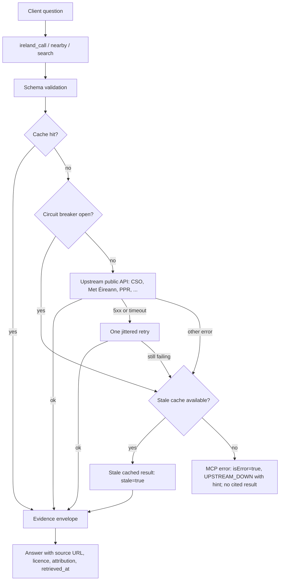

# Architecture

The server is a stateless Azure Functions Flex app with a lean gateway in front of the source modules. The gateway owns the operation index, response budgets, cache, upstream budgets, circuit breakers, one jittered retry for transient 5xx/timeout failures and evidence envelope; every normal result includes source URL, licence, attribution and retrieval metadata.

| Diagram | Editable source |
| --- | --- |
|  | [`ireland-mcp-arch-v5.drawio`](architecture/ireland-mcp-arch-v5.drawio) |
|  | [`ireland-mcp-request-flow.drawio`](architecture/ireland-mcp-request-flow.drawio) |
|  | [`ireland-mcp-lean-surface.drawio`](architecture/ireland-mcp-lean-surface.drawio) |

  

How a call flows:

## Operations

- `GET /healthz` is fast liveness; `GET /healthz?deep=1` performs one cheap check per source.
- A status workflow publishes [`status/status.json`](https://raw.githubusercontent.com/c-mongan/ireland-mcp/status/status/status.json) and 7-day history.
- OpenTelemetry can export MCP semantic-convention spans and operation-duration metrics to Azure Monitor.
- Tool logs and telemetry avoid argument values and IP addresses. See [PRIVACY.md](../PRIVACY.md).
- Optional PostHog usage metrics and Chromatic visual checks are described in [observability](observability.md) and the [quality loop](quality-loop.md).
- Browser CORS is restricted by `MCP_ALLOWED_ORIGINS`; non-browser MCP clients are unaffected.
