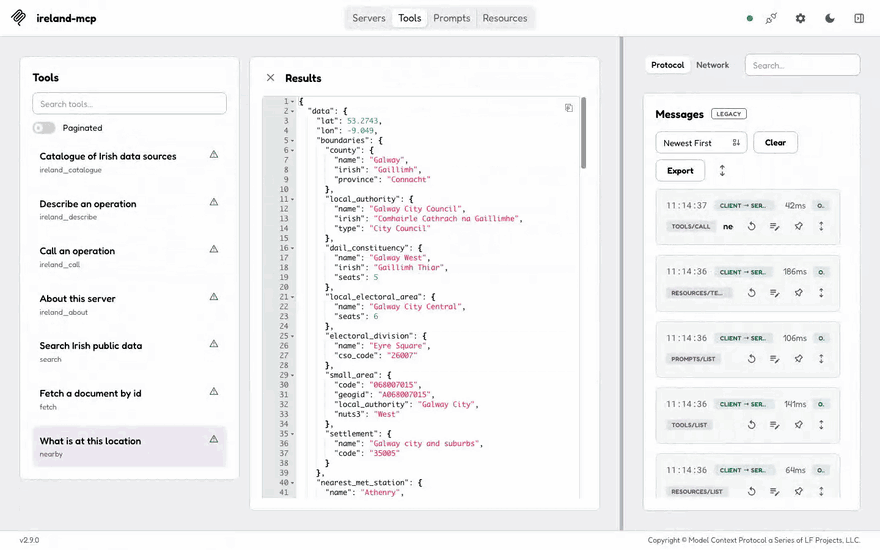
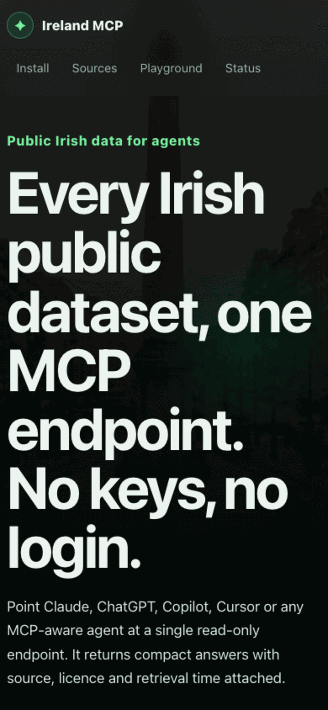
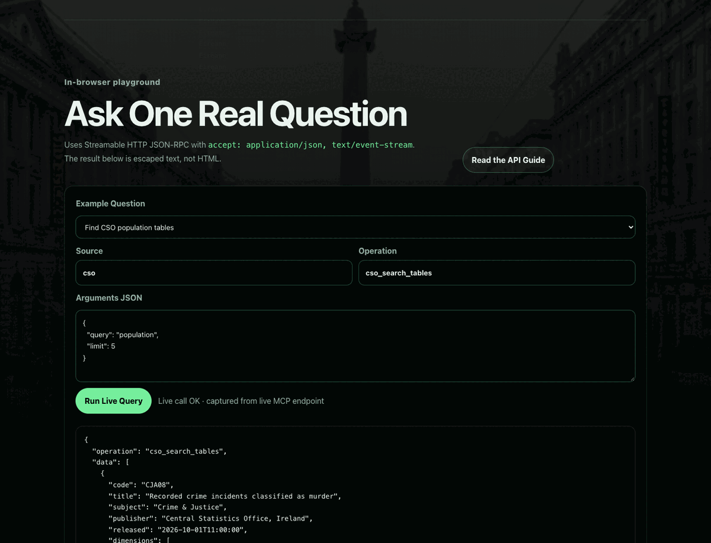
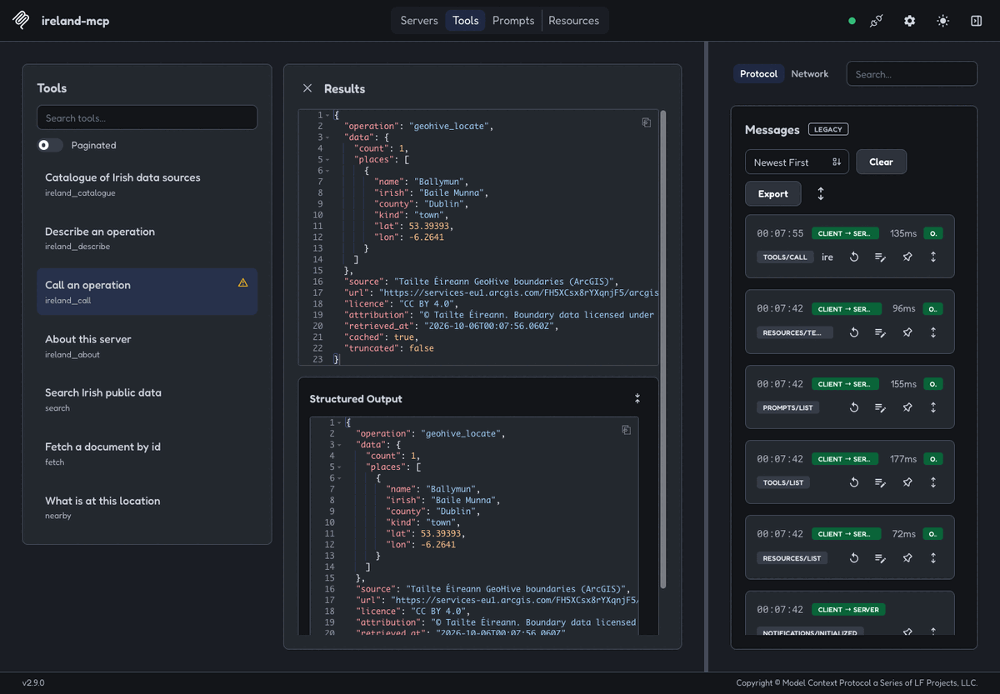
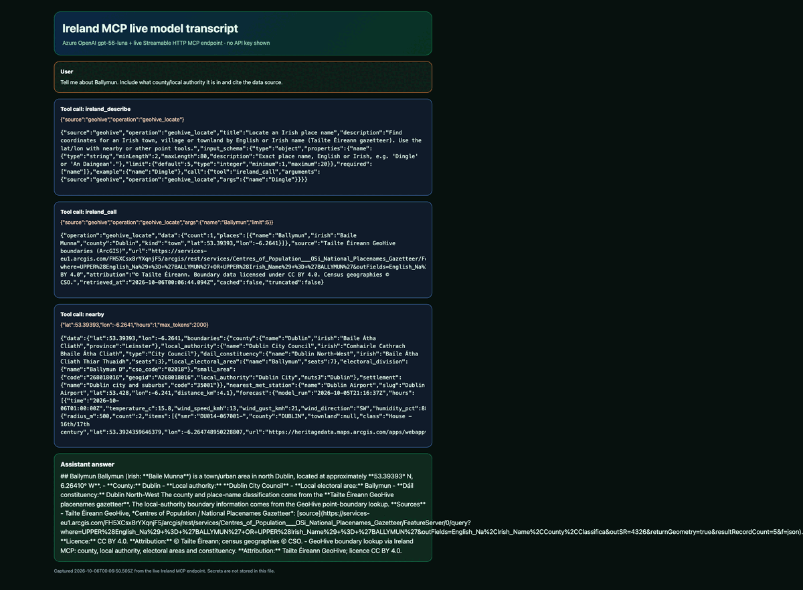
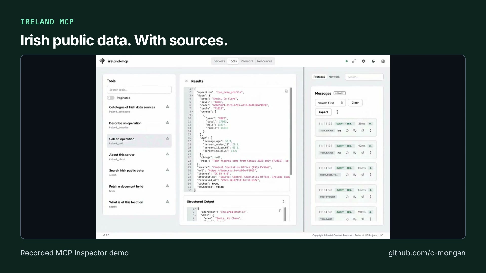

# Evidence

What has been checked against the hosted endpoint, and how.

  

| Client (tested 7 Oct 2026 against the hosted endpoint) | Result |
| --- | --- |
| MCP Inspector (Playwright, [`scripts/demo-inspector.mjs`](../scripts/demo-inspector.mjs)) | 4/4 calls (`nearby`, CSO, Met Éireann, PPR) returned data with citations. [CSO Ennis](demo/inspector-cso-ennis.png), [PPR Galway 2024](demo/inspector-ppr-galway-2024.png). |
| VS Code Insiders, Copilot agent mode | Census 2022 Ennis (27,923 people) and Galway forecast, with CSO and Met Éireann citations. [Screenshot](demo/vscode-copilot-chat.png). |
| GitHub Copilot CLI | 3/3 questions answered with citations: Met Éireann Galway, PPR Cork, CSO Ennis. [Evidence](demo/README.md). |

## Screenshots

| Proof | Screenshot |
| --- | --- |
| Live landing page, desktop |  |
| Live landing page, mobile |  |
| Install section with one-click client setup |  |
| Playground populated from a real live MCP call |  |
| MCP Inspector connected to the live endpoint |  |
| Real model transcript: question → tool calls → answer |  |

## Video

<!-- portfolio-video:start -->

## Short video overview

**21 seconds.** Recorded MCP Inspector example. Figures and forecasts are historical.

[Watch on GitHub](https://github.com/c-mongan/ireland-mcp/releases/tag/portfolio-overview-2026-10-23) · [Download MP4](https://github.com/c-mongan/ireland-mcp/releases/download/portfolio-overview-2026-10-23/ireland.mp4) · [Transcript](portfolio-video/transcript.txt) · [Captions](portfolio-video/captions.srt) · [Credits and source notes](portfolio-video/README.md)
<!-- portfolio-video:end -->
